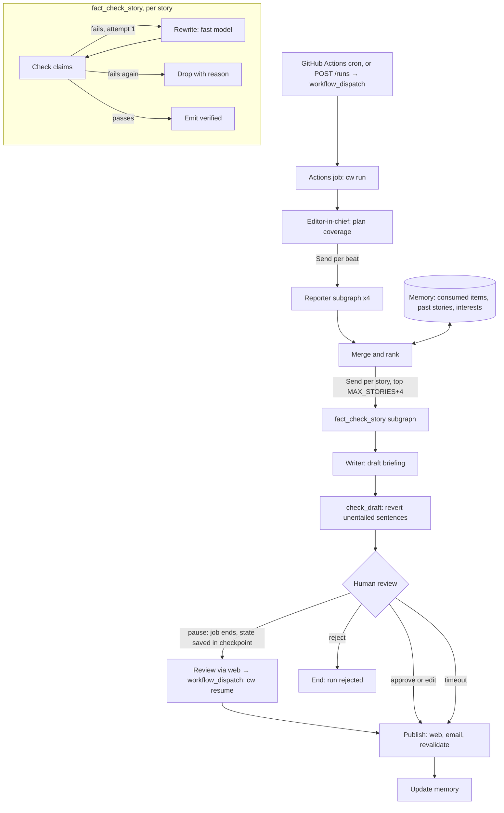

# Context Window — build plan (v2)

A multi-agent AI newsroom that publishes a verified daily briefing on AI for engineers.
Reporter agents cover separate beats in parallel, a fact-checker checks every claim
against its cited primary source, and an editor assembles the briefing. Built on LangGraph.

This file is the full specification and the build order. Work through the phases in
order. Each phase has a "done when" check; do not start the next phase until it passes.

v2 is a revision after a design review. The changes are listed in section 16.
v2.1 moves hosting to free tiers only: GitHub Actions runs the newsroom, Vercel hosts the
web app and the API, and Neon hosts the database. There is no Railway and no QStash.

---

## 1. What we are building

**The reader:** an AI engineer who wants to know what changed in AI today and whether
it affects their work, without reading twenty feeds.

**The product:** every morning a briefing of up to 10 stories appears on a web page and
arrives by email. On a light day with fewer than 5 verified stories, the briefing
says so instead of padding. Each story has a headline, a two-sentence summary in the
newsroom's own words, a "why it matters" line, and links to the sources that were checked.

**What makes it different from a news summarizer**

1. **A releases beat.** It watches the changelogs of a configurable list of tools
   (LangGraph, model SDKs, MCP, and so on) and says what changed and whether it is a
   breaking change.
2. **Checked claims.** Every factual sentence in a story cites a claim, and every claim
   is checked against its cited primary source (defined per beat in section 6.6). A
   story that fails gets one rewrite. If it still fails, it is dropped. Only supported
   claims are published.
3. **Memory.** A story that appears on three sites shows up once. It does not reappear
   on later days unless there is something new, such as a new version or a new primary item.
4. **Personal ranking.** Thumbs up and thumbs down adjust the interest weights used in
   ranking. With one reader the signal is weak, so the effect is deliberately small.
5. **A live newsroom view.** You can watch the agents work in real time.

**Not in scope for version 1:** multiple users and accounts, paid sources, social
media scraping, audio or video output, mobile apps, a settings UI (settings are a YAML
file plus a CLI), and npm release tracking.

---

## 2. How it works



**Execution model (free setup).** No server runs the graph. A GitHub Actions job does.

- **Starting a run.** A scheduled workflow (`newsroom.yml`, cron in `BRIEFING_TZ`)
  runs `cw run`. A manual run comes from `POST /runs` or the "Run workflow" button,
  which trigger the same workflow through `workflow_dispatch`.
- **One run at a time.** The job inserts the `runs` row, which is idempotent on
  `run_date`, and executes the graph with `thread_id = run_id`. A workflow
  `concurrency` group stops two runs from overlapping.
- **Pausing for review.** When the graph pauses at `human_review`, the checkpoint is
  already saved in Postgres. The job sets the run to `awaiting_review` and exits, so no
  Actions minutes are spent waiting.
- **Resuming.** A review decision (`POST /runs/{id}/review`) is saved, then the API
  triggers `workflow_dispatch` with `cw resume <run_id>`, which continues with
  `Command(resume=decision)`.
- **Review timeout.** A second short scheduled job (`review-timeout.yml`) runs
  `REVIEW_TIMEOUT_HOURS` after the daily run. It auto-approves any run still waiting.
- **Crash recovery.** If a job dies (timeout or runner failure), the run's heartbeat
  goes stale. The next `cw run` or `cw resume` first resumes stale runs from their
  checkpoint with `ainvoke(None, config)`.
- **Live events.** Graph events are written to a `run_events` table. The web app polls
  it through the API about every 2 seconds. This replaces SSE, because serverless
  functions can't hold long streams.
- **Local development.** `cw run` and `cw api` run on your machine against the Neon
  `dev` branch.

**The agents**

| Agent | Job | Model tier |
|---|---|---|
| Editor-in-chief | Reads the watchlist, interests and yesterday's briefing; decides what each reporter should look for today | Strong |
| Reporter (x4) | Fetches with deterministic code through MCP tools, filters out consumed items, and writes story candidates with explicit claims in batched calls | Fast |
| Merge and rank | Groups candidates about the same event into one story, scores them and keeps the top pool | Embeddings, plus a fast model for borderline pairs |
| Fact-checker | Judges each claim against the trimmed primary source | Fast first, then strong for `unclear` claims |
| Rewriter | Removes or corrects failed claims. It may not add new facts | Fast |
| Writer | Assembles the final briefing in a consistent voice | Strong |
| Draft checker | Flags any sentence in the draft that the verified stories do not support | Fast |

**The beats and their sources**

| Beat | Sources | Access method |
|---|---|---|
| Research | Hugging Face daily papers is the primary list. arXiv (cs.AI, cs.CL, cs.LG) provides abstracts and full text, pre-filtered by interest embedding before any model call | HF daily-papers API, arXiv API |
| Releases | GitHub Releases for watchlist repos; PyPI per-project release RSS (`/rss/project/<pkg>/releases.xml`) | GitHub REST API, RSS |
| Industry | Official blogs of AI labs and tool makers | RSS feeds |
| Community | Hacker News stories (`search_by_date`, `tags=story`, last 24 h, points ≥ 50, AI keyword filter from the assignment) | Algolia HN Search API |

---

## 3. Tech stack

| Layer | Choice | Notes |
|---|---|---|
| Language (agents) | Python ≥ 3.12, pinned to 3.13 in `.python-version` | |
| Orchestration | LangGraph 1.x | `Send` fan-out, subgraphs with input/output schemas, `interrupt()` / `Command(resume=…)` |
| Checkpointer | `langgraph-checkpoint-postgres` (`AsyncPostgresSaver`) | Direct (non-pooled) connection, `autocommit=True`, `dict_row` |
| Model access | LangChain chat model interface (`init_chat_model`) with `langchain-openrouter` | Provider and model names come from environment variables. OpenRouter is the provider (approved 2026-10-08); structured output uses `json_schema` with `require_parameters` routing so only providers that enforce the schema are used |
| Typed outputs | Pydantic v2 with structured output | Every agent returns a validated schema, never free text |
| Tools | MCP servers built with standalone `fastmcp` 4, called through FastMCP's own `Client` over stdio | One persistent session per server per run, not one per call. `langchain-mcp-adapters` was dropped (checked 2026-10-08): 0.3.1 fails to import against MCP 2 and 0.3.2 pins `mcp<2`, while FastMCP 4 requires MCP 2. Reporters call tools directly, so no LangChain tool wrapping is needed |
| API | FastAPI, deployed on Vercel's Python runtime (Fluid compute) | Short requests only. Live events are polled from `run_events`. `POST /runs` and review trigger GitHub `workflow_dispatch` |
| Worker | GitHub Actions jobs running `cw run` / `cw resume` | `newsroom.yml` (daily cron plus dispatch) and `review-timeout.yml`. Use a private repo: scheduled workflows in public repos are disabled after 60 days without commits |
| Database | Neon Postgres 18 with pgvector 0.8 | Branch `dev` for local work, `production` for deployed. Docker (`pgvector/pgvector:0.8.7-pg18`) is an optional offline alternative |
| Migrations | Alembic with SQLAlchemy 2 (async) | Excludes the checkpointer's tables |
| Scheduling | GitHub Actions `schedule` (cron with an IANA time zone) | It may start a few minutes late, especially at the top of the hour, so schedule at an odd minute such as :17 |
| Tracing and evals | LangSmith | Tracing on from Phase 4. Cost is enforced locally; LangSmith only reports it |
| Front end | Next.js 16 (App Router), TypeScript, Tailwind CSS v4, shadcn/ui | Server components for reading pages |
| Data fetching (web) | TanStack Query | Only on the client screens (live view, review) |
| Graph view (web) | React Flow (`@xyflow/react`) | |
| Email | Jinja2 HTML template plus the Resend Python SDK | Rendered in the Python publish node. React Email was dropped because it needs Node |
| Hosting (all free tiers) | Vercel Hobby: the web app (Next.js) and the API (FastAPI) as two projects from one repo. GitHub Actions: the newsroom jobs. Neon free plan: the database | Total cost $0 plus model usage (OpenRouter) |
| Python tooling | uv, Ruff, pytest (+ pytest-asyncio), pyright | Live-network tests are marked `live` and excluded from CI. `link-mode = "copy"` in both Python projects: OneDrive folders reject uv's hardlinks and leave installs half-done |
| Feeds and pages | feedparser (RSS, Atom, arXiv API), trafilatura (main text for fact-checking), lxml | Approved 2026-10-08 |
| JS tooling | Node 24 LTS, pnpm, ESLint, Prettier | |
| CI | GitHub Actions | Lint, type-check and tests on every push |

**Important for the coding assistant:** these libraries change quickly. Before using
LangGraph, MCP, FastMCP, langchain-mcp-adapters, LangSmith, Next.js or shadcn/ui APIs,
check the current official documentation. Do not rely on remembered signatures or pin
versions from memory. Install the latest stable versions and record them in the lock files.

---

## 4. Repository structure

```
context-window/
├── PLAN.md                      this file
├── README.md                    public-facing; written in Phase 11
├── docker-compose.yml           local Postgres with pgvector
├── .env.example
├── .github/workflows/
│   ├── ci.yml                   lint, types, tests, build
│   ├── newsroom.yml             daily cron + workflow_dispatch: cw run / cw resume
│   └── review-timeout.yml       auto-approves runs left waiting for review
├── config/
│   └── settings.toml            sources, watchlist, interests (seed and source of truth; TOML
│                                so the standard library parses it, no YAML dependency)
├── apps/
│   ├── api/                     Python package: API (Vercel) + newsroom CLI (GitHub Actions)
│   │   ├── pyproject.toml
│   │   ├── src/context_window/
│   │   │   ├── db/migrations/   Alembic, shipped inside the package (run with `cw db init`)
│   │   │   ├── config.py        settings from environment
│   │   │   ├── budget.py        run-scoped cost and call budget
│   │   │   ├── events.py        writes run_events (public / admin)
│   │   │   ├── worker.py        starts and resumes runs, heartbeat, stale-run recovery
│   │   │   ├── dispatch.py      triggers GitHub workflow_dispatch from the API
│   │   │   ├── db/              models, session, queries
│   │   │   ├── schemas/         Pydantic models shared by agents and API
│   │   │   ├── graph/
│   │   │   │   ├── state.py     graph state and reducers
│   │   │   │   ├── newsroom.py  the main graph
│   │   │   │   ├── reporter.py  reporter subgraph
│   │   │   │   ├── fact_check.py fact_check_story subgraph
│   │   │   │   └── nodes/       editor, rank, writer, check_draft, review, publish, memory
│   │   │   ├── prompts/         one file per agent
│   │   │   ├── mcp_client.py    persistent MCP sessions per run
│   │   │   ├── memory/          canonical keys, dedupe, interests, embeddings
│   │   │   ├── api/             FastAPI routers
│   │   │   ├── email/           Jinja2 template and sender
│   │   │   └── cli.py           `cw` command
│   │   └── tests/
│   └── web/                     Next.js app
│       ├── app/
│       │   ├── page.tsx                 latest briefing
│       │   ├── briefings/[date]/page.tsx
│       │   ├── newsroom/page.tsx        live run view
│       │   ├── login/page.tsx           admin login
│       │   └── api/
│       │       ├── admin/[...path]/route.ts  server-side proxy that adds ADMIN_TOKEN
│       │       └── revalidate/route.ts       called by publish
│       ├── components/
│       └── lib/
├── mcp-servers/                 one package (`context_window_mcp`), one module per server,
│   │                            each runnable alone: `python -m context_window_mcp.<name>`
│   ├── src/context_window_mcp/
│   │   ├── http.py              shared polite client: UA, rate limits, retries, size cap, cache
│   │   ├── rss.py               also used for PyPI release feeds
│   │   ├── github_releases.py
│   │   ├── arxiv.py
│   │   ├── hf_papers.py
│   │   ├── hackernews.py
│   │   └── web_fetch.py         robots.txt, hidden-text stripping, main-text extraction
│   ├── scripts/record_fixtures.py   records real responses, sanitised (no article text)
│   └── tests/                   fixture replay + `-m live` tests against the real APIs
└── evals/
    ├── datasets/
    └── run_evals.py
```

---

## 5. Data model

| Table | Purpose | Key columns |
|---|---|---|
| `sources` | Feeds and APIs to read | id, beat, kind, name, url (unique), authority (1 to 5), options (JSONB, e.g. arXiv categories, HN min points), enabled |
| `watchlist_repos` | Repos tracked by the releases beat | id, owner, repo (lower-case, unique pair), pypi_package (nullable), tag_pattern (regex the tag must fully match; filters monorepos such as langgraph's `cli==` and `sdk==` tags), enabled |
| `interests` | Topics the reader cares about | id, topic (unique), description (the text that is embedded), weight (0.2 to 2.0), embedding, embedding_model |
| `items` | Every raw item fetched | id, source_id, url, canonical_url, canonical_key, title, excerpt (≤ 500 chars), published_at, content_hash, fetched_at, consumed_at |
| `runs` | One row per newsroom run | id, run_date, trigger (`schedule` / `manual`), status, started_at, finished_at, heartbeat_at, actions_run_url, stats (JSON), trace_url |
| `run_events` | Event log for streaming and replay | id (bigserial), run_id, ts, node, kind, public (bool), payload (JSONB) |
| `stories` | Stories produced by a run | id (UUIDv7), run_id, run_date, beat, headline, summary, why_it_matters, is_breaking_change, published_at, score, status, drop_reason, embedding, embedding_model |
| `story_sources` | Links a story to its source items | story_id, item_id |
| `claims` | Each checkable claim in a story | id, story_id, text, source_url, verdict, evidence_url, evidence_quote (≤ 300 chars), evidence_kind (`page` / `feed`), reasoning, attempts, checked_at |
| `briefings` | The published output | id, run_id, date (unique), status, body_markdown, emailed_at |
| `feedback` | Reader votes | id, story_id (unique, upsert), value (+1 or -1), created_at, updated_at |
| `fetch_cache` | Per-run page cache shared across MCP sessions | run_id, url, status, body, fetched_at. Purged after 7 days |

**Constraints and indexes**
- `items`: unique `(source_id, canonical_url)`, index on `canonical_key`.
- `runs`: partial unique index on `run_date` where status is active (`queued`, `running`,
  `awaiting_review`, `resume_requested`). A published date is detected in code, so a
  forced re-run is possible without deleting history.
- Enums are stored as VARCHAR plus a CHECK constraint, not native Postgres enums, so new
  values need no `ALTER TYPE`.
- The vector column dimension comes from `EMBEDDING_DIM` (default 1536). At this
  volume (under 10k rows a year) exact search is fine. Add HNSW only if dim ≤ 2000.

**Canonical keys:** arXiv uses `arxiv:<id without version>`, GitHub uses
`gh:<owner>/<repo>@<tag>`, PyPI uses `pypi:<pkg>@<version>`, and everything else uses the
normalised URL (lower-case host, https, no tracking params, no trailing slash, no fragment).

**Status values**
- Run: `queued`, `running`, `awaiting_review`, `resume_requested`, `published`, `rejected`, `expired`, `failed`.
- Story: `candidate`, `verified`, `dropped`, `published`.
- Claim verdict: `supported`, `unsupported`, `unclear`.
- Drop reason: `unsupported`, `unclear_only`, `fetch_failed`, `budget`, `removed_by_editor`.

The LangGraph checkpointer creates its own tables with `AsyncPostgresSaver.setup()`,
called from `cw db init`. Alembic's `include_object` excludes the `checkpoint*` tables
so autogenerate never tries to drop them.

---

## 6. Graph specification

### 6.1 State

Main graph state:

| Field | Type | Reducer | Notes |
|---|---|---|---|
| `run_id` | str | replace | |
| `run_date` | date | replace | Local date in `BRIEFING_TZ` |
| `assignments` | list[BeatAssignment] | replace | Written by the editor |
| `candidates` | list[StoryCandidate] | `operator.add` | Parallel reporters append |
| `stories` | list[Story] | replace | After merge and rank (the fact-check pool) |
| `verified` | list[Story] | `operator.add` | Parallel fact-check branches append |
| `dropped` | list[DroppedStory] | `operator.add` | Parallel fact-check branches append |
| `draft` | Briefing or None | replace | |
| `review` | ReviewDecision or None | replace | |
| `stats` | RunStats | merge (sum numbers, concatenate errors, merge timings) | Written by every node |

Rules:
- The reporter and fact-check subgraphs have private state with explicit input and output schemas. Raw items and page text never enter the parent state.
- Fetched page text never goes into graph state. It lives in `fetch_cache`, which keeps checkpoints small.
- Graph state is not used to enforce the cost cap (see 6.5).

### 6.2 Core schemas (Pydantic)

- **BeatAssignment:** beat, focus (what to look for today), max_items.
- **Claim:** id, text, source_url, verdict (optional), evidence_url (optional),
  evidence_quote (optional), evidence_kind (optional), reasoning (optional), attempts.
- **StoryCandidate:** beat, headline, summary (2 sentences max), why_it_matters
  (1 sentence), claims (1 to 4), sentence_claim_map (each factual sentence → claim ids),
  source_urls, canonical_keys, published_at, is_breaking_change (releases beat only).
- **Story:** everything in StoryCandidate plus id, score, merged_from (count), attempts.
- **ClaimVerdict:** claim_id, verdict, evidence_url, evidence_quote, evidence_kind, reasoning (short).
- **DroppedStory:** story_id, headline, beat, reason (drop reason enum), claims.
- **RunStats:** items_fetched_by_beat, candidates, merged, checked, verified, dropped,
  claims_supported, claims_unsupported, claims_unclear, model_calls, tokens_in,
  tokens_out, cost_usd, errors (list of {node, source, message}), timings_ms (node → ms).
- **Briefing:** date, intro (1 sentence), stories (ordered), light_day (bool), stats.
- **ReviewDecision:** action (`approve`, `edit`, `reject`), edited_stories,
  removed_story_ids, decided_by (`human` / `timeout`).

### 6.3 Nodes

| Node | Input | Output | Rules |
|---|---|---|---|
| `plan_coverage` | watchlist, interests, yesterday's headlines | `assignments` | One assignment per enabled beat. A beat is enabled when it has at least one enabled source |
| `reporter` (subgraph, one per beat via `Send`) | one assignment | appends to `candidates` | **Fetch:** deterministic code calls MCP tools; the model does not choose tools. **Filter:** keep items whose `canonical_key` is not consumed and that were first fetched less than 72 h ago. **Save:** store new items. **Summarise:** batched fast-model calls (≤ 10 items per call), with bodies truncated to about 1.5k tokens. Cap items per beat. Every factual sentence must map to a claim |
| `merge_and_rank` | `candidates` | `stories` | Assign UUIDv7 ids and persist the stories as `candidate`. **Merge:** within the run, merge pairs at cosine ≥ 0.85; for 0.75 to 0.85 ask a fast model "same event?". Merges add to the cross-source count. **Releases:** dedupe by (repo, version), not by embedding. **Suppress:** drop stories at cosine ≥ 0.88 to a story published in the last 14 days, unless a new version or new canonical key is present. **Score** with 6.4 and keep the top `FACT_CHECK_POOL` (default 14), with beat quotas of at least 1 and at most 4 per beat |
| `fact_check_story` (subgraph, one per story via `Send`) | `{story}` | appends to `verified` or `dropped`, plus stats | **Group** claims by source page. **Fetch** each page once with web-fetch, through `fetch_cache`. **Trim** to the top ~3k tokens of passages relevant to the claims (chunk + embed). **Judge** all of a page's claims in one fast-model call, escalating to the strong model only for `unclear`. **Quote check:** `evidence_quote` must be found in the fetched text after whitespace normalisation, or the verdict becomes `unclear`. **Pass:** every remaining claim is `supported` and every factual sentence cites a supported claim. **Otherwise:** one rewrite, then re-check only the changed claims. **Otherwise:** drop with a reason |
| `rewrite` (inside `fact_check_story`) | story plus verdicts | revised story | Fast model. It may remove or correct unsupported or unclear claims, and remove the sentences that cite them. It may not add new facts. Maximum one rewrite |
| `write_briefing` | `verified` | `draft` | Takes the top `MAX_STORIES` verified stories, ordered by score, with breaking-change releases first. Sets `light_day` when fewer than 5 are verified. Uses only facts in the verified stories |
| `check_draft` | `draft`, `verified` | `draft` | Fast model with structured output. It flags any draft sentence that the verified stories do not support, and flagged sentences are reverted to the verified wording |
| `human_review` | `draft` | `review` | Does nothing non-idempotent before `interrupt()`, because the node re-runs on resume. Skipped when `REVIEW_MODE=auto`. The Actions job exits while paused. After `REVIEW_TIMEOUT_HOURS`, `review-timeout.yml` resumes it with `approve` and `decided_by=timeout`. Edited sentences are re-checked; if that is not possible they are shown as "edited by the editor". `reject` ends the run as `rejected` and publishes nothing |
| `publish` | `draft`, `review` | briefing row, email, revalidate | Upserts the briefing by date. Sends with the Resend idempotency key `briefing-<date>`. Calls the web revalidate endpoint. A forced re-run replaces the briefing and does not re-send the email unless `--resend` is given |
| `update_memory` | published stories | | Marks the stories `published` and sets `consumed_at` on their items. Stores the embeddings and finalises the run stats |

A new day's run marks any older run still in `awaiting_review` as `expired`.

### 6.4 Ranking score

`score = 0.40 * interest_match + 0.25 * source_authority + 0.20 * recency + 0.15 * cross_source`

All four components are in the range 0 to 1:

- `interest_match = max over interests of clamp((cos − 0.25) / 0.45, 0, 1) × (weight / 2.0)`.
  The rescale is needed because raw cosine from modern embedding models clusters around 0.2 to 0.6.
- `source_authority = (best authority − 1) / 4`.
- `recency`: measured from run start. It is 1.0 within 24 hours and falls linearly to 0
  at 72 hours. For arXiv, use the announcement date (or the HF daily-papers date), not
  the v1 submission date.
- `cross_source = (min(independent domains, 3) − 1) / 2` for the industry and community
  beats. A repost of the same URL or an HN thread does not count as independent. Releases
  and research are single-source by nature, so they get a fixed 0.5.

**Feedback:** each story has one vote, and changing it replaces the old vote. For the
top 2 interests with cosine ≥ 0.30 to the story:
`w ← clamp(w + 0.1 × vote × cos, 0.2, 2.0)`. A changed vote reverses the previous nudge.

**Calibration:** all thresholds in 6.3 and 6.4 depend on the embedding model. In
Phase 5, calibrate them on about 100 hand-labelled story pairs and record the results.
Done 2026-10-08 for `openai/text-embedding-3-small`: merge at 0.81, ask the fast model
between 0.70 and 0.81, suppress at 0.84 (`evals/calibration/merge-thresholds.md`). The
pairs are labelled by construction (model-written rewrites of real stories as same-event
pairs, the nearest different real stories as different-event pairs) rather than by hand.

### 6.5 Reliability and budget

- Every node handles tool failure without crashing the run. A reporter whose source is
  down returns what it has and records the error in `stats.errors`.
- **Budget:** a run-scoped `Budget` object (contextvar plus a LangChain callback handler)
  records tokens × the price table (`MODEL_PRICES`) on every model call and raises
  `BudgetExceeded` when a cap is hit. Graph state can't do this, because parallel
  branches can't see each other's writes. When a node catches `BudgetExceeded`, it stops
  checking, drops the remaining stories with reason `budget`, and the run publishes what
  is verified.
- **Caps:** `MAX_COST_PER_RUN_USD=1.50` (hard cap; the design target is about $0.80),
  `MAX_MODEL_CALLS_PER_RUN=150` (tripwire) and `MAX_ITEMS_PER_BEAT=40`.
- **Estimate:** with illustrative prices (strong ≈ $3/$15 per M tokens, fast ≈ $1/$5),
  the design above costs about $0.45 to $0.80 per run. A naive per-claim strong-model
  fact-check would cost about $1.65 or more. Re-check this against the chosen provider's
  real prices in Phase 4.
- **Crash recovery:** a running job writes a heartbeat every 30 s. Before starting new
  work, `cw run` and `cw resume` resume any run in `running` whose heartbeat is older
  than 2 minutes, using `ainvoke(None, config)`. The newsroom job has
  `timeout-minutes: 45` and a `concurrency` group, so two jobs never run at once.
- **Database:** the checkpointer and the Actions jobs use `DATABASE_URL_DIRECT`, a
  non-pooled connection, through `AsyncConnectionPool` with a connection health check
  (Neon scales to zero). The API on Vercel uses the pooled `DATABASE_URL`, with a small
  pool created per function instance. Set `LANGGRAPH_STRICT_MSGPACK=true`
  and allowlist the project's Pydantic modules.
- **Prompt injection:** agents that read fetched text have no tools and return
  structured output only. Fetched content is wrapped in labelled delimiters under a
  system rule that it is data, not instructions. The deterministic quote check is the
  real defence. web-fetch strips scripts, comments and hidden elements.

### 6.6 Primary sources by beat

| Beat | Primary source | Never counts |
|---|---|---|
| Releases | The repo's release or tag page, or its CHANGELOG | Third-party blog posts about the release |
| Research | The arXiv full text (HTML or PDF), not only the abstract | Social posts about the paper |
| Industry | The organisation's own post | Press coverage of it |
| Community | The article the HN story links to | The HN thread or comments |

If the page is blocked by robots.txt, paywalled or rendered only with JavaScript, the
check falls back to the feed content or release body that was already fetched, and
records `evidence_kind=feed`.

---

## 7. MCP servers

Each server is a small standalone `fastmcp` server with its own tests. All tools return
structured data and never raise on an empty result.

| Server | Tools |
|---|---|
| `arxiv` | `search_recent(categories, since, max_results)` and `get_paper(arxiv_id)`. Both return title, abstract, authors, url, published_at and announced_at |
| `hf-papers` | `list_daily(date)` returns title, arxiv_id, upvotes, url, published_at |
| `github-releases` | `list_releases(owner, repo, since)` returns tag, name, body, url, published_at. `get_release(owner, repo, tag)` |
| `rss` | `fetch_feed(url, since)` returns title, link, summary, published_at. Also used for PyPI release feeds |
| `hackernews` | `search_stories(query, since, min_points)` returns title, url, hn_url, points, comment_count, created_at |
| `web-fetch` | `fetch_page(url)` returns cleaned main text, title, final url and status. Limits: 2 MB raw, about 8k tokens cleaned. A robots.txt denial returns `status=blocked`; it never raises |

**Rules for all servers**
- Set a descriptive User-Agent with a contact URL.
- Apply timeouts and polite rate limits. arXiv allows 1 request every 3 seconds.
- web-fetch respects `robots.txt`.

**Sessions and caching**
- `mcp_client.NewsroomTools` starts each server's stdio process on first use and keeps
  it for the whole run, so a run pays start-up once per server, not once per call.
- Each server inherits a minimal environment plus only what it needs; `GITHUB_TOKEN`
  reaches the GitHub server alone.
- Feeds and API responses are cached in the server process, which lives for one run.
  Fetched evidence pages are cached in the `fetch_cache` table, so a resumed run does not
  fetch them again.
- Every tool returns a structured result with an `error` (or `status`) field instead of
  raising; only invalid arguments raise.

**Tests** use FastMCP's in-memory transport against recorded fixtures.

---

## 8. API

| Method and path | Purpose | Auth |
|---|---|---|
| `POST /runs` | Trigger `newsroom.yml` through `workflow_dispatch`; returns 202. Refused with 409 while a run for today is active, or once it is published (`force=true` to override). `review=manual` makes the run pause for review (scheduled runs review automatically) | Admin token |
| `GET /runs` | Recent runs, newest first (added in Phase 7: after `POST /runs` the job creates the run, so this is how to find it) | Public (same fields as below) |
| `GET /runs/{id}` | Run status and public stats | Public (`trace_url` and `actions_run_url` are admin only) |
| `GET /runs/{id}/events?after=<event id>` | Events from `run_events` newer than `after`; the web app polls about every 2 s | Public: sanitised events only (node, status, counts, timings). Admin: full events including agent output and draft |
| `POST /runs/{id}/review` | Record a review decision, then trigger `workflow_dispatch` to run `cw resume` | Admin token |
| `GET /briefings/latest` | Latest published briefing | Public |
| `GET /briefings/{date}` | Briefing for a date | Public |
| `GET /briefings` | Archive list | Public |
| `POST /stories/{id}/feedback` | Thumbs up or down (upsert) | Admin token |
| `GET /settings`, `PUT /settings` | Watchlist, sources, interests (used by the CLI) | Admin token |
| `GET /health` | Health check (DB reachable, worker heartbeat age) | Public |

**Security**
- Version 1 has a single reader. Write actions are protected by one `ADMIN_TOKEN`.
- The browser never sees `ADMIN_TOKEN`. The Next.js server attaches it.
- CORS allows only `WEB_ORIGIN`.
- The API triggers workflows with `GITHUB_DISPATCH_TOKEN`, a fine-grained token limited
  to this repo with only the "Actions: read and write" permission.

---

## 9. Front end

**Screens**

1. **Briefing (`/`)** — a server component. It shows the date, a one-line run status,
   three small stat tiles (items scanned, stories kept, claims verified), beat filter
   pills, then the stories as bordered rows. Each row has a beat label, headline,
   summary, "why it matters", and a "Checked against N sources" line that expands to
   show the links. Thumbs up and down appear only with an admin session. A light-day
   note appears when it applies.
2. **Archive (`/briefings/[date]`)** — the same layout for past dates, with previous
   and next links.
3. **Live newsroom (`/newsroom`)** — the agent graph drawn with React Flow. The dynamic
   branches (4 reporters and about 14 fact-checks) are drawn from `run_events` as
   stacked child nodes, not from the static graph. The page polls the events endpoint
   about every 2 seconds while a run is active. Nodes light up as they run. Public
   viewers see sanitised progress. An admin sees agent output in a side panel and, when
   the run pauses for review, the draft with approve, edit, remove and reject controls.
4. **Login (`/login`)** — a password sets an httpOnly, Secure, SameSite=Lax signed
   session cookie (`ADMIN_SESSION_SECRET`). Admin calls, including polling admin events,
   go through `app/api/admin/*` route handlers, which add `ADMIN_TOKEN` on the server.

**Freshness:** publish calls `POST /api/revalidate` (`REVALIDATE_SECRET`) so cached pages
update immediately.

**Design rules**

- One reading column, maximum width about 720px, generous white space.
- A serif typeface for headlines, a sans-serif for everything else.
- Neutral palette. Colour is used only for beat labels and status.
- Bordered rows for stories, not heavy cards. No gradients or shadows.
- Light and dark mode from the start.
- Sentence case for all labels.
- Works well on a phone.

---

## 10. Evaluation

Results go in the README.

| Metric | How it is measured | Target |
|---|---|---|
| Fact-checker agreement | Fact-checker verdicts compared with hand labels on a 60-claim dataset that includes deliberately false and subtly altered claims (built in Phase 6) | 90% or higher |
| Claim accuracy | Hand-check 50 published claims against their sources | 95% or higher supported |
| Unverified sentence rate | Share of published sentences with no supported claim behind them | Under 2% |
| Duplicate rate | Share of published stories that repeat an earlier one in a 14-day window | Under 3% |
| Coverage | Share of a hand-made weekly list of 15 major AI stories that appeared in the briefings | 70% or higher |
| Cost per run | Local Budget, cross-checked with LangSmith | Report it; target about $0.80 |
| Run time | From run stats | Report it |

Store the datasets in `evals/datasets/` and in LangSmith. `evals/run_evals.py` runs
them and prints a table.

---

## 11. Rules the project must follow

1. **Own words, with links.** Summaries are written fresh and kept short. Never copy
   article text into a story. Store titles, links, dates, an item excerpt of at most 500
   characters, and an evidence quote of at most 300 characters. Raw page text lives only
   in `fetch_cache` and is purged after 7 days.
2. **No invented facts.** The writer may only use what is in the verified stories, and
   `check_draft` enforces this.
3. **Respect sources.** Use official APIs and feeds. Obey `robots.txt` and rate limits.
   Credit arXiv in the footer.
4. **Secrets stay out of the repo.** Everything sensitive lives in environment
   variables. Commit `.env.example` only. Never put a secret in a `NEXT_PUBLIC_*` variable.
5. **Spend caps.** Every run has a hard limit on model calls and cost, enforced by the Budget.
6. **Tests with every phase.** MCP servers are tested against recorded fixtures, and
   graph nodes are tested with mocked tools and models. Live-network tests are marked
   `live` and do not run in CI.
7. **Email deliverability.** `RESEND_FROM` must be on a verified domain (SPF and DKIM).

---

## 12. Build phases

### Phase 0 — Accounts and tools (done by you, not the coding assistant)

- [x] Install Python 3.13, Node 24 LTS, uv and pnpm. Docker is optional.
- [x] Create a private GitHub repository named `context-window`.
- [x] Get an OpenRouter API key with a credit limit. Note the per-token prices of the chosen models in Phase 4.
- [ ] Get an embeddings key (Gemini free tier, or a local model).
- [ ] Create a LangSmith account and API key.
- [x] Create a GitHub personal access token with public read access (for release data).
- [x] Create a Neon project (Postgres 18, AWS US East 1) with a `dev` branch.
- [ ] Create a Vercel account, because a skeleton is deployed in Phase 1.
- [ ] Later: a Resend account. Without a domain, send from Resend's test address to your own email.

### Phase 1 — Scaffold and skeleton deploy

1. Create the folder structure from section 4.
2. Set up `apps/api` with uv, Ruff, pyright and pytest. Add `cw` with `api` and `worker` subcommands. The worker is an empty loop with a heartbeat.
3. Set up `apps/web` with Next.js 16, TypeScript, Tailwind v4 and shadcn/ui.
4. Connect to the Neon `dev` branch. Add `docker-compose.yml` as an optional offline database.
5. Add `.env.example` with every variable from section 13.
6. Add a GitHub Actions workflow that lints, type-checks and tests both apps.
7. Deploy the skeleton: the web app and the API as two Vercel projects, plus a
   `newsroom.yml` workflow that runs `cw worker --once` on dispatch.

**Done when:**
- The Neon `dev` branch is reachable with both URLs and pgvector is available.
- The API serves `/health` locally and on Vercel.
- `newsroom.yml` runs from the "Run workflow" button and logs a heartbeat.
- The web app shows a placeholder page on Vercel.
- CI passes.

### Phase 2 — Data layer

1. Define SQLAlchemy models for every table in section 5.
2. Create the first Alembic migration: enable pgvector, use `EMBEDDING_DIM`, add the
   indexes and the partial unique index, and add an `include_object` filter for the
   checkpointer tables.
3. Add `cw db init`, which runs migrations and `AsyncPostgresSaver.setup()`.
4. Write `config/settings.toml` with starter sources, a repo watchlist and five starter
   interests (agent frameworks, evaluation, MCP, retrieval, model releases). Add
   `cw settings load` to seed it.
5. Write query helpers: canonicalise a URL or key, check whether a key is consumed, save
   items, find similar stories, create a run (one active run per date) and find stale runs.

Known source gaps (checked 2026-10-08): Anthropic, Meta AI and Mistral publish no RSS feed,
and the LangChain blog's feed now redirects to HTML. Their news reaches the briefing only
through Hacker News and the releases beat until a fetcher for their news pages is added.

**Done when:**
- `cw db init` runs cleanly on an empty database, locally and on Neon.
- The settings load.
- The helpers, including the canonicalisation cases, have passing tests.

### Phase 3 — MCP servers

1. Build `rss`, then `github-releases`, `arxiv`, `hf-papers`, `hackernews` and `web-fetch`.
2. Record real responses as fixtures and test each server against them with the in-memory transport.
3. Write `mcp_client.py`, with persistent per-run sessions and `fetch_cache`, and
   `cw mcp list` / `cw mcp call <server> <tool> '<json>'`.

**Done when:**
- Each server can be called on its own from the command line and returns real data (a `live` test).
- All fixture tests pass.
- A run opens one session per server, not one per call.

### Phase 4 — One reporter, end to end

1. Define the schemas from section 6.2 and the state reducers from section 6.1.
2. Add the Postgres checkpointer and the `Budget`, using real provider prices.
3. Build the reporter subgraph for the releases beat only.
4. Add a CLI command: `cw run --beat releases`.
5. Turn on LangSmith tracing.
6. Print the resulting story candidates and save the items to the database.

**Done when:**
- One command fetches real releases for the watchlist and produces valid story candidates with sentence-to-claim maps.
- A second run skips consumed items.
- The full trace is visible in LangSmith.
- The Budget's cost matches LangSmith's within 10%.

### Phase 5 — The full newsroom

1. Add `plan_coverage` and fan out to all four reporters in parallel with `Send`.
2. Add embeddings and `merge_and_rank` with the score from section 6.4, including beat quotas.
3. Build a set of about 100 labelled story pairs and calibrate the thresholds.
4. Add `write_briefing` and save the result as a draft briefing.
5. Make `cw run` execute the whole graph.

**Done when:**
- One command runs four reporters in parallel.
- Duplicates across beats are merged and counted as cross-source.
- Thresholds are recorded with their calibration results.
- A ranked draft briefing is written to the database.

### Phase 6 — Trust

1. Build the 60-claim fact-checker dataset first, including false and subtly altered claims.
2. Add the `fact_check_story` subgraph with grouping, trimming, the quote check, the rewrite and the drop rule.
3. Add `check_draft`.
4. Add `human_review` with the interrupt, `REVIEW_MODE=manual|auto`, the review timeout and the reject path.
5. Add `publish` (Jinja2 email through Resend, with an idempotency key) and `update_memory`.
6. Add `cw resume`, the heartbeat and stale-run recovery. Then wire `newsroom.yml`
   (cron plus dispatch with `run`/`resume`) and `review-timeout.yml`.

**Done when:**
- Fact-checker agreement on the dataset is at least 90%.
- A story with a planted false claim is corrected or dropped.
- A run killed halfway through (cancel the Actions job) resumes from its checkpoint on the next `cw run` or `cw resume`.
- A run in manual mode pauses, then continues after a review decision from the CLI.
- A review timeout auto-approves.

### Phase 7 — API and live events

1. Implement the endpoints in section 8, and deploy the API to Vercel.
2. Write public and admin events to `run_events`, and serve them from the polling
   endpoint. Capture subgraph progress with
   `astream(..., subgraphs=True, stream_mode=["updates", "custom"])`.
3. Add admin-token protection, CORS and `workflow_dispatch` triggering with a
   fine-grained token.

**Done when:**
- A run can be started, followed by polling with `curl` (public and admin), reviewed and published entirely through the deployed API.
- Triggering a second run for the same date does not create a duplicate.

### Phase 8 — Front end

1. Build the briefing page and archive as server components, with on-demand revalidation.
2. Build login and the server-side admin proxy.
3. Build the live newsroom with React Flow and the event stream.
4. Build the review controls.
5. Add feedback buttons, shown only to the admin, wired to the API.
6. Check dark mode and phone layout.

**Done when:** you can read today's briefing, watch a run live, log in, approve a draft
and vote on stories, all from the browser. `ADMIN_TOKEN` does not appear in the client bundle.

### Phase 9 — Schedule and email in production

1. Set up Resend. Use the test sender to your own address, or verify a domain if you have one.
2. Add the repository secrets for Actions, and enable the `newsroom.yml` cron in `BRIEFING_TZ` at an odd minute.
3. Point production at the Neon `production` branch, and set `REVIEW_MODE=auto` there.
4. Add basic monitoring. GitHub emails you when a workflow fails; also email from the job when a run ends `failed`.

**Done when:** a briefing is published and emailed on three consecutive days with no
manual steps.

### Phase 10 — Evaluation

1. Let the scheduled newsroom run for a week.
2. Write `evals/run_evals.py` for the metrics in section 10.
3. Hand-check the claims and coverage.
4. Fix the weakest metric and re-run.

**Done when:** there is a results table with real numbers for every metric.

### Phase 11 — Launch

1. Write the README: what it is, a screenshot, the agent graph, the stack, the results
   table, how to run it locally, and an honest limitations section. Note that MCP is used
   as an architecture choice, and that plain functions would be simpler.
2. Record a 60-second demo of the live newsroom.
3. Add a licence and tidy the commit history.
4. Share it.

**Done when:** a stranger can clone the repo and get a local briefing by following the
README.

---

## 13. Environment variables

```
# Models
MODEL_PROVIDER=
MODEL_STRONG=
MODEL_FAST=
MODEL_API_KEY=
MODEL_PRICES=                    # JSON: {"<model>": {"in": 3.0, "out": 15.0}} per M tokens
EMBEDDING_PROVIDER=
EMBEDDING_MODEL=
EMBEDDING_DIM=1536
EMBEDDING_API_KEY=

# Database
DATABASE_URL=                    # pooled, for the API
DATABASE_URL_DIRECT=             # non-pooled, for the worker and checkpointer
LANGGRAPH_STRICT_MSGPACK=true

# Tracing
LANGSMITH_API_KEY=
LANGSMITH_PROJECT=context-window
LANGSMITH_TRACING=true

# Sources
GITHUB_TOKEN=
HF_TOKEN=                        # optional
MAX_FETCH_BYTES=2000000

# App
ADMIN_TOKEN=
BRIEFING_TZ=Asia/Kolkata
REVIEW_MODE=manual               # set to auto in production
REVIEW_TIMEOUT_HOURS=3
MAX_STORIES=10
FACT_CHECK_POOL=14
MAX_ITEMS_PER_BEAT=40
MAX_MODEL_CALLS_PER_RUN=150
MAX_COST_PER_RUN_USD=1.50
PUBLIC_API_URL=
WEB_ORIGIN=

# Web (server-side only unless prefixed NEXT_PUBLIC_)
ADMIN_PASSWORD=
ADMIN_SESSION_SECRET=
REVALIDATE_SECRET=
NEXT_PUBLIC_API_URL=

# GitHub Actions dispatch (used by the API to start and resume runs)
GITHUB_DISPATCH_TOKEN=           # fine-grained, this repo only, Actions: read and write
GITHUB_REPOSITORY=YashKamerkar14/context-window

# Email
RESEND_API_KEY=
RESEND_FROM=
BRIEFING_EMAIL_TO=
```

---

## 14. After version 1

- True live streaming: run the API on an always-on host (for example Railway) and replace
  the 2-second polling with SSE from `run_events` (`Last-Event-ID` replay, 15 s heartbeat).
  The events table and endpoint shape are already designed for this, so it is a swap,
  not a rewrite.
- A settings UI for the watchlist, sources and interests.
- npm release tracking through the registry JSON.
- A weekly digest that picks the most important stories of the week.
- A "what changed in my stack" page built only from the releases beat.
- Publish the newsroom itself as an MCP server so other agents can ask it for news.
- More beats: funding, policy, open-source models.
- Multiple readers with their own interests.

---

## 15. How to work on this project (for the coding assistant)

1. Do one phase at a time, in order. Stop at the end of each phase, show the "done
   when" check passing, and wait for confirmation before continuing.
2. Check current official documentation before using any fast-moving library.
3. Keep functions small and typed. Every agent output is a Pydantic model.
4. Write tests alongside the code, not afterwards.
5. Commit after each numbered step with a clear message.
6. Ask before adding a dependency that is not in section 3.
7. Never put secrets in code, commits or `NEXT_PUBLIC_*` variables.
8. If something in this plan turns out to be wrong or outdated, say so and propose a
   change instead of working around it silently.

---

## 16. Changes from v1

| Area | v1 problem | v2 change |
|---|---|---|
| Execution | No worker; runs held inside a QStash request (which times out and retries) | Queue + `cw worker`, 202 response, heartbeat and resume, `run_events` for SSE |
| Fact-check graph | Parallel writes without reducers; rewrite unreachable from a `Send` branch | `fact_check_story` subgraph; additive reducers; stats merge reducer |
| What "verified" covers | Only claims checked; summary and writer output unchecked; reporter picks its own source | Sentence-to-claim map, quote check, `check_draft`, primary source defined per beat |
| Cost | Estimated ~$1.65 per run against a $1.00 cap; cap kept in state (not enforceable) | Batched, trimmed, fast-first checking (~$0.45–0.80); run-scoped Budget; $1.50 hard cap |
| Review | Manual default made "no manual steps" impossible | Timeout auto-approve; reject path; auto mode in production |
| Dedupe | URL-only at fetch time; destroyed cross-source counts and lost unpublished stories | Canonical keys; `consumed_at` set only on publish; cross-source merge in rank |
| Ranking | Score unbounded (weight up to 2.0); releases and research always penalised | All components 0–1; fixed cross-source value for single-source beats; beat quotas; calibration |
| Briefing size | Top 10 checked, so drops made it short | Check 14, publish 10, light-day note |
| Embeddings | Fixed migration dimension vs swappable model; 3072 dims can't use an HNSW index | `EMBEDDING_DIM`, `embedding_model` column, startup assert |
| Security | Public stream leaked drafts; admin token placement undefined; public thumbs needed the admin token | Sanitised public events, login + server proxy, stream tokens, CORS |
| Email | React Email can't render from Python | Jinja2 + Resend Python SDK, idempotency key |
| MCP | Adapter opens a new stdio session per call; in-server cache can't work | Persistent per-run sessions, `fetch_cache` table |
| Sources | HF papers and PyPI listed with no server; HN query undefined | `hf-papers` server, PyPI via RSS, defined HN query, npm deferred |
| Ops | No timezone; no run idempotency; Neon pooling vs checkpointer | `BRIEFING_TZ`, idempotency key, partial unique index, direct DB URL |
| Phasing | Deploy last; checkpointer late; eval dataset late | Skeleton deploy in Phase 1; checkpointer in Phase 4; dataset gates Phase 6; schedule before eval |
| Tooling | Node 20 is end-of-life; FastMCP package ambiguous | Node 24 LTS, Python 3.13, standalone `fastmcp`, pyright |
| Hosting (v2.1) | Railway (about $5 a month) and QStash | GitHub Actions jobs run the newsroom (cron plus dispatch, pause and resume through checkpoints). FastAPI and Next.js on Vercel Hobby. Neon free. Polling instead of SSE |
