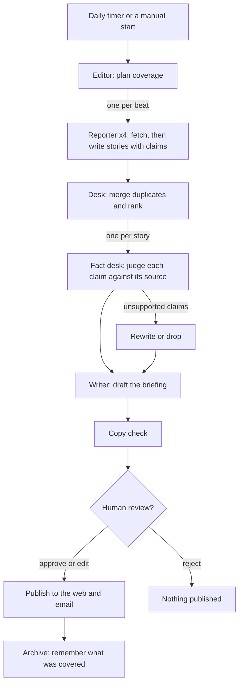

# Context Window

**A newsroom of AI agents that publishes a verified daily briefing on AI for engineers.**

Every morning, eleven agents read about 250 sources, decide what matters, check every
claim against its source, and publish a short briefing to the web and by email. You can
watch them work, live or as a replay of a past run.

**Live site: [context-window-gamma.vercel.app](https://context-window-gamma.vercel.app)**
· [Watch the newsroom](https://context-window-gamma.vercel.app/newsroom)


## What it does

1. **Plans coverage.** An editor agent reads the watchlist and reader interests and
   briefs four reporters.
2. **Reports.** The releases, research, industry and community reporters run in
   parallel. They read GitHub releases and PyPI, Hugging Face daily papers and arXiv,
   AI lab blogs, and Hacker News through MCP servers, and each writes up candidate
   stories with every claim tied to a source.
3. **Merges and ranks.** The desk drops stories already covered in the last two weeks,
   merges duplicates by embedding similarity, and ranks the rest.
4. **Fact-checks.** For each of the top 14 stories, every claim is checked against the
   source page and given a verdict with a quoted piece of evidence. Stories whose claims
   fail are rewritten without them, or dropped.
5. **Writes.** The writer drafts the intro from the verified stories, and a copy check
   makes sure the intro says nothing the stories don't.
6. **Reviews and publishes.** The run can pause for a human editor to approve, edit or
   reject the draft. Production approves automatically. The publisher then puts the
   edition on the site and emails it, and the archivist records what was covered.

## How it works



- **LangGraph** runs the newsroom. Reporters and fact-checks fan out in parallel, each
  as its own subgraph. Every step is checkpointed in Postgres, so a crashed run resumes
  where it stopped, and a run paused for review costs nothing while it waits.
- **Every agent output is a typed Pydantic model.** Each summary sentence must map to
  the claims behind it, and only claims the fact desk marked "supported" can reach print.
- **Budgets are enforced per run** (model calls and cost), and every model call is
  traced in LangSmith.
- **The web app is derived from the run's event log.** The newsroom floor replays any
  past run from the same events it shows live.

## Results

Measured with [`evals/run_evals.py`](evals/run_evals.py) on the first three editions
(10 to 12 October 2026). Full details are in [`evals/results.md`](evals/results.md).

| Metric | Result | Target |
|---|---|---|
| Fact-checker agreement with human labels (60 claims, 40 of them false or subtly altered) | **98.3%** (59/60) | 90% or higher |
| Claim accuracy (50 published claims, hand-checked against the source) | **100%** (50/50) | 95% or higher |
| Unverified sentence rate (summary sentences with no supported claim) | **0%** (0/41) | under 2% |
| Duplicate rate (stories repeated within 14 days) | **0%** (0/21) | under 3% |
| Coverage of the week's major AI stories | pending: needs a full week | 70% or higher |
| Cost per run | **$0.03** | about $0.80 |
| Run time | **about 2 minutes** | report |

Three editions is a small sample, and the numbers will be re-run after a full week. The
claim sample was hand-checked by an AI assistant (a different model from the newsroom's
fact-checker) against each source page, with notes on every borderline case in
[`claim_accuracy.jsonl`](evals/datasets/claim_accuracy.jsonl). The fact-checker's
benchmark is in [`evals/factcheck/agreement.md`](evals/factcheck/agreement.md).

## Stack

| Part | Technology |
|---|---|
| Agents | Python 3.13, LangGraph, LangChain, Claude Haiku via OpenRouter, Pydantic |
| Tools | Model Context Protocol servers built with FastMCP (GitHub releases, RSS and Atom, arXiv, Hugging Face papers, Hacker News, page fetching) |
| Data | Neon Postgres with pgvector, SQLAlchemy 2 (async), Alembic, LangGraph's Postgres checkpointer |
| API | FastAPI on Vercel |
| Web | Next.js 16, React 19, TypeScript, Tailwind CSS, React Flow, TanStack Query |
| Operations | GitHub Actions for the runs, Vercel Cron for the daily start, LangSmith tracing, Resend email |
| Quality | 220 backend tests, Ruff, Pyright (strict), ESLint, CI on every push |

All of it runs on free tiers.

## Repository layout

```
apps/api/        the newsroom (LangGraph), the CLI (`cw`) and the FastAPI app
apps/web/        the Next.js site: briefing, archive, newsroom floor, login and review
mcp-servers/     the MCP servers the reporters and the fact desk use
config/          starter sources, watchlist and interests (settings.toml)
evals/           evaluation datasets, calibration notes and run_evals.py
.github/         CI, the daily newsroom job and the review timeout
PLAN.md          the design document the project was built from
```

## Run it locally

You need **Python 3.13 with [uv](https://docs.astral.sh/uv/)**, **Node 24 with pnpm**,
and a **Postgres database with pgvector**. A free [Neon](https://neon.tech) project
works, or run `docker compose up -d` for a local one on port 5433. You also need an
**[OpenRouter](https://openrouter.ai) API key** (a run costs a few cents) and a
**GitHub token** with no scopes (for reading public releases).

1. Clone the repository and copy the settings:

   ```sh
   git clone https://github.com/YashKamerkar14/context-window.git
   cd context-window
   cp .env.example .env
   ```

2. In `.env`, set `MODEL_API_KEY` and `GITHUB_TOKEN`. If you use Neon, set
   `DATABASE_URL` to its pooled connection string and `DATABASE_URL_DIRECT` to the
   direct one. The Docker defaults already match `docker compose`.

3. Set up the database and run the newsroom:

   ```sh
   cd apps/api
   uv sync
   uv run cw db init         # migrations and the checkpointer's tables
   uv run cw settings load   # sources, watchlist and interests from config/settings.toml
   uv run cw run             # about 2 minutes; pauses for your review at the end
   ```

   The run prints its stories and the draft, then waits. Publish it with:

   ```sh
   uv run cw review <run id> approve
   ```

   Set `REVIEW_MODE=auto` in `.env` to skip the pause.

4. Optional, to see it in the browser: start the API with `uv run cw api`. Then, in
   `apps/web`, copy `.env.example` to `.env.local`, and run `pnpm install` and
   `pnpm dev`. Open http://localhost:3000.

Run the tests with `uv run pytest` in `apps/api` and `mcp-servers`, and the evaluation
with `uv run --project apps/api python evals/run_evals.py` from the repository root.

## Limitations

- **Small evaluation so far.** The results cover three editions. Coverage needs a
  hand-made list of a full week's major stories, and the claim sample was checked by an
  AI assistant rather than a person.
- **The fact desk checks claims against the cited source, not against the world.** If a
  source is wrong, a claim that faithfully repeats it passes.
- **Sources are a fixed starter set**: GitHub and PyPI for a watchlist of 12 projects,
  two paper feeds, nine AI lab and engineering blogs, and Hacker News. Paywalled and
  JavaScript-only pages are out of reach.
- **One small model does all the work.** Claude Haiku keeps a run at a few cents. A
  stronger model would write better prose.
- **MCP is an architecture choice here, not a necessity.** The servers keep the tools
  separate, testable and reusable by other agents, but plain functions would be simpler
  for a single app.
- **The live view polls every two seconds** rather than streaming, because the free
  hosting has no long-lived server.
- **Email uses Resend's test sender**, which can only deliver to the account owner's
  address until a domain is verified.

## Licence

[MIT](LICENSE)
