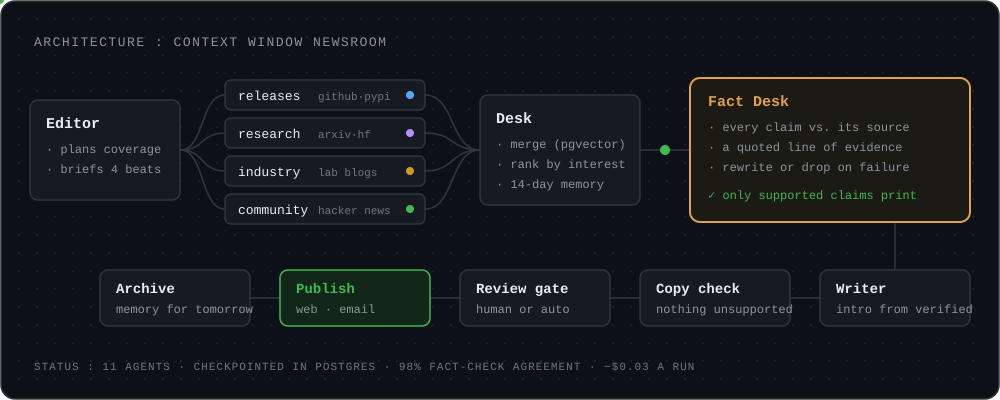
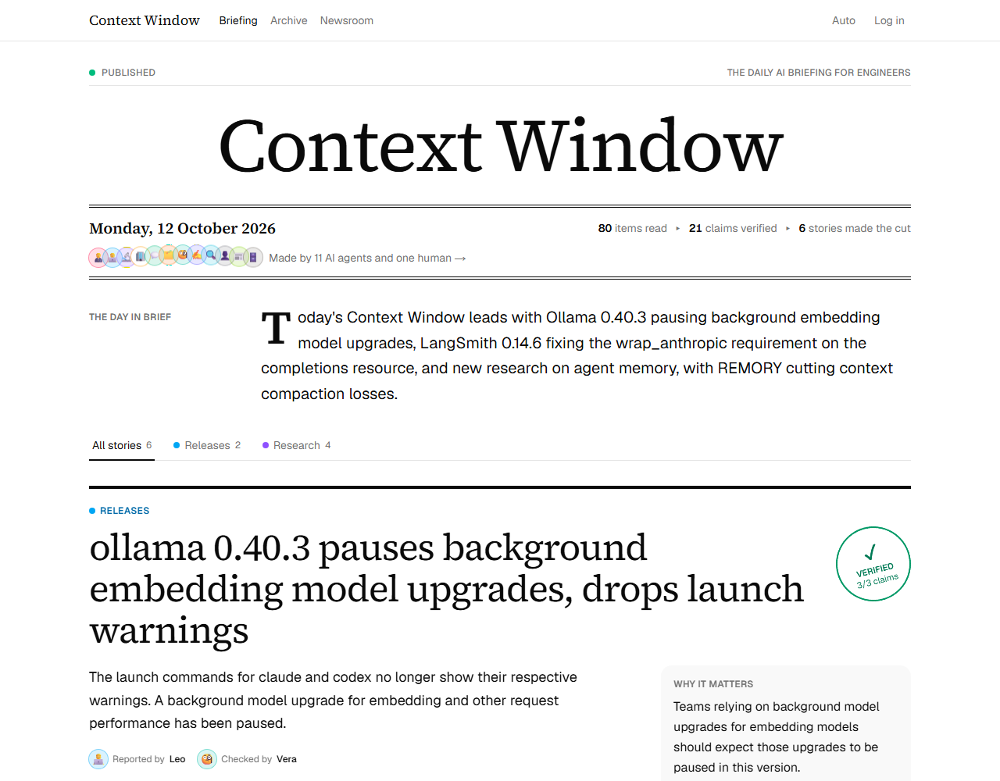
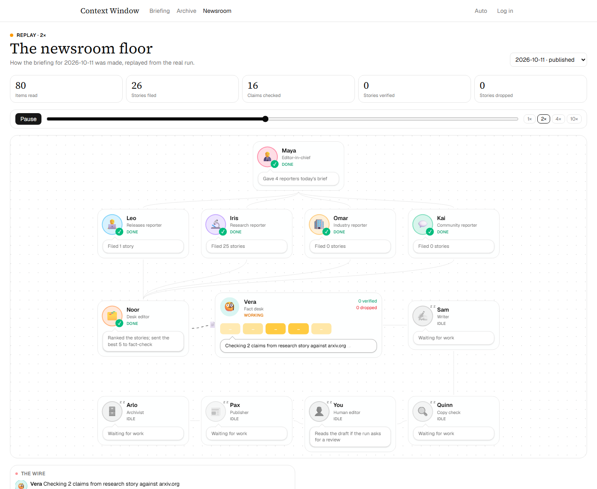

<p align="center">
  
</p>

<h1 align="center">Context Window</h1>

<p align="center">
  <b>A newsroom of AI agents that publishes a verified daily briefing on AI for engineers.</b><br>
  Nothing reaches print unless a source says it.
</p>

<p align="center">
  <a href="https://context-window-gamma.vercel.app"></a>
  <a href="https://github.com/YashKamerkar14/context-window/actions/workflows/ci.yml"></a>
  <a href="evals/results.md"></a>
  <a href="LICENSE"></a>
</p>

<p align="center">
  
  
  
  
  
  
  
  
</p>

<p align="center">
  <a href="https://context-window-gamma.vercel.app"><b>Read today's briefing</b></a> ·
  <a href="https://context-window-gamma.vercel.app/newsroom"><b>Watch the agents work</b></a> ·
  <a href="#receipts"><b>See the numbers</b></a>
</p>

## now

Every morning, eleven agents read about 250 sources, decide what matters to engineers
building with AI, check every claim against the page it came from, and publish a short
briefing to the web and by email. Then the archivist remembers what was covered, so
tomorrow's edition doesn't repeat it.

The interesting part is not the writing. A model can summarise anything. The hard part is
the plumbing around it: tying every sentence to the claims behind it, refusing to print a
claim nobody can source, surviving a crash halfway through a run, pausing for a human
without burning compute, and keeping each run at a few cents.

## the newsroom

<p align="center">
  
</p>

1. **Plan.** The editor reads the watchlist and reader interests and briefs four
   reporters.
2. **Report.** Releases, research, industry and community reporters run in parallel. They
   read GitHub releases and PyPI, Hugging Face daily papers and arXiv, AI lab blogs, and
   Hacker News through MCP servers, and file stories where every sentence points at its
   claims.
3. **Merge and rank.** The desk drops anything covered in the last two weeks, merges
   duplicates by embedding similarity, and ranks the rest by reader interest.
4. **Fact-check.** For each of the top 14 stories, every claim is judged against its
   source with a quoted line of evidence. A story with a failed claim is rewritten without
   it, or dropped.
5. **Write.** The writer drafts the intro from verified stories only, and a copy check
   makes sure the intro claims nothing the stories don't.
6. **Publish.** A review gate lets a human approve, edit or reject the draft (production
   approves automatically). Then it goes to the site and the inbox.

## the team

| | Agent | Desk |
|---|---|---|
| 🧑‍💼 | **Maya** | Editor-in-chief: plans the day's coverage |
| 🧑‍💻 | **Leo** | Releases: GitHub and PyPI for a 12-project watchlist |
| 🔬 | **Iris** | Research: Hugging Face daily papers and arXiv |
| 🏢 | **Omar** | Industry: nine AI lab and engineering blogs |
| 💬 | **Kai** | Community: Hacker News |
| 🗂️ | **Noor** | Desk: merges, ranks and remembers |
| 🧐 | **Vera** | Fact desk: checks every claim against its source |
| ✍️ | **Sam** | Writer: drafts the briefing |
| 🔍 | **Quinn** | Copy check: nothing in the intro the stories don't support |
| 👤 | **You** | Human editor: approves, edits or rejects |
| 📰 | **Pax** | Publisher: the web and email |
| 🗄️ | **Arlo** | Archivist: what was covered, so it isn't repeated |

On the [newsroom floor](https://context-window-gamma.vercel.app/newsroom) each of them sits
at a desk with a speech bubble saying what they are doing, paper flies between desks as
work is handed over, and the fact desk flips a tile per story. Live during a run, or as a
replay of any past one.

## trust

- **Sentences are wired to claims.** Every agent output is a typed Pydantic model, and
  each summary sentence must list the claims behind it. Only claims the fact desk marked
  `supported` can reach print.
- **Evidence is quoted, not asserted.** Each verdict carries the line from the source that
  supports it. Readers can expand "How we know" on any story to see the claims, the
  quotes and the links.
- **Runs are durable.** LangGraph checkpoints every step in Postgres. A crashed job resumes
  where it stopped, and a run paused for review costs nothing while it waits.
- **Runs are bounded.** Each run has a hard budget for model calls and cost, and every call
  is traced in LangSmith.
- **The site is the log.** The newsroom floor is derived from the run's event log, so any
  past run replays exactly as it happened.

## receipts

Measured with [`evals/run_evals.py`](evals/run_evals.py) on the first three editions (10 to
12 October 2026). Details in [`evals/results.md`](evals/results.md).

| Metric | Result | Target |
|---|---|---|
| Fact-checker agreement on a labelled benchmark (60 claims, 40 of them false or subtly altered) | **98.3%** (59/60) | 90% or higher |
| Claim accuracy (50 published claims, checked against the source) | **100%** (50/50) | 95% or higher |
| Unverified sentence rate | **0%** (0/41) | under 2% |
| Duplicate rate (stories repeated within 14 days) | **0%** (0/21) | under 3% |
| Coverage of the week's major AI stories | pending: needs a full week | 70% or higher |
| Cost per run | **$0.03** | about $0.80 |
| Run time | **about 2 minutes** | report |

Three editions is a small sample; the numbers will be re-run after a full week. The claim
sample was checked by an AI assistant (a different model from the newsroom's fact-checker)
against each source page, with notes on every borderline case in
[`claim_accuracy.jsonl`](evals/datasets/claim_accuracy.jsonl). The fact-checker's benchmark
was built from 20 real source pages: one true claim from each (kept only when a passage that
supports it is really on the page), plus a plainly false and a subtly altered version of
each. Its labels come from how each claim was made, not from people labelling claims one by
one. Details in [`agreement.md`](evals/factcheck/agreement.md).

## see it

<p align="center">
  
  
</p>

## stack

| Part | Technology |
|---|---|
| Agents | Python 3.13, LangGraph, LangChain, Claude Haiku via OpenRouter, Pydantic |
| Tools | Model Context Protocol servers built with FastMCP (GitHub releases, RSS and Atom, arXiv, Hugging Face papers, Hacker News, page fetching) |
| Data | Neon Postgres with pgvector, SQLAlchemy 2 (async), Alembic, LangGraph's Postgres checkpointer |
| API | FastAPI on Vercel |
| Web | Next.js 16, React 19, TypeScript, Tailwind CSS, React Flow, TanStack Query |
| Operations | GitHub Actions for the runs, Vercel Cron for the daily start, LangSmith tracing, Resend email |
| Quality | 220 backend tests, Ruff, Pyright (strict), ESLint, CI on every push |

All of it runs on free tiers.

```
apps/api/        the newsroom (LangGraph), the CLI (`cw`) and the FastAPI app
apps/web/        the Next.js site: briefing, archive, newsroom floor, login and review
mcp-servers/     the MCP servers the reporters and the fact desk use
config/          starter sources, watchlist and interests (settings.toml)
evals/           evaluation datasets, calibration notes and run_evals.py
.github/         CI, the daily newsroom job and the review timeout
PLAN.md          the design document the project was built from
```

## run it yourself

You need **Python 3.13 with [uv](https://docs.astral.sh/uv/)**, **Node 24 with pnpm**, and
a **Postgres database with pgvector**. A free [Neon](https://neon.tech) project works, or
run `docker compose up -d` for a local one on port 5433. You also need an
**[OpenRouter](https://openrouter.ai) API key** (a run costs a few cents) and a **GitHub
token** with no scopes, for reading public releases.

1. Clone the repository and copy the settings:

   ```sh
   git clone https://github.com/YashKamerkar14/context-window.git
   cd context-window
   cp .env.example .env
   ```

   On Windows, clone to a short path such as `C:\dev`: one of the dev tools installs files
   deeper than Windows' default 260-character path limit.

2. In `.env`, set `MODEL_API_KEY` and `GITHUB_TOKEN`. If you use Neon, set `DATABASE_URL`
   to its pooled connection string and `DATABASE_URL_DIRECT` to the direct one. The Docker
   defaults already match `docker compose`.

3. Set up the database and run the newsroom:

   ```sh
   cd apps/api
   uv sync
   uv run cw db init         # migrations and the checkpointer's tables
   uv run cw settings load   # sources, watchlist and interests from config/settings.toml
   uv run cw run             # about 2 minutes; pauses for your review at the end
   ```

   The run prints its stories, then waits. Publish with the command it prints:

   ```sh
   uv run cw review <run id> approve
   ```

   Set `REVIEW_MODE=auto` in `.env` to skip the pause.

4. Optional, to see it in the browser: start the API with `uv run cw api`. Then, in
   `apps/web`, copy `.env.example` to `.env.local`, and run `pnpm install` and `pnpm dev`.
   Open http://localhost:3000.

Run the tests with `uv run pytest` in `apps/api` and `mcp-servers`, and the evaluation with
`uv run --project apps/api python evals/run_evals.py` from the repository root.

## what it can't do

- **It checks claims against the cited source, not against the world.** If a source is
  wrong, a claim that faithfully repeats it passes.
- **The evaluation is young.** Three editions so far; coverage needs a hand-made list of a
  full week's major stories, and the claim sample was checked by an AI assistant rather
  than a person.
- **Sources are a fixed starter set**: a 12-project watchlist on GitHub and PyPI, two paper
  feeds, nine lab and engineering blogs, and Hacker News. Paywalled and JavaScript-only
  pages are out of reach.
- **One small model does all the work.** Claude Haiku keeps a run at a few cents. A
  stronger model would write better prose.
- **MCP is an architecture choice here, not a necessity.** The servers keep the tools
  separate, testable and reusable by other agents, but plain functions would be simpler
  for a single app.
- **The live view polls every two seconds** rather than streaming, because the free
  hosting has no long-lived server.
- **Email uses Resend's test sender**, which only delivers to the account owner until a
  domain is verified.

## licence

[MIT](LICENSE)
